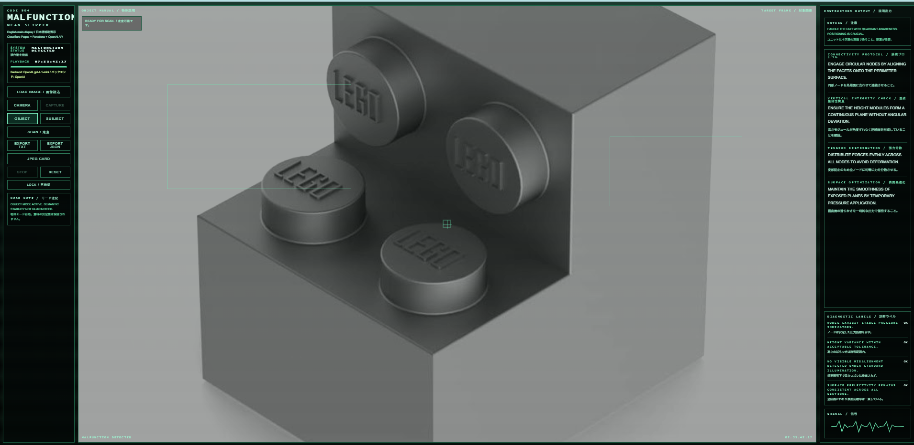

# CODE 904 / MALFUNCTION / MEAN SLIPPER

レトロなHUD風インターフェースで、画像から「もっともらしいが役に立たない説明書」を生成するWebアプリです。
Cloudflare Pages + Functions + OpenAI API を使用し、パスワード制限付きで安全に運用できます。

---

## 🧪 デモ

実際の実行画面はこちら
👉 code-904.pages.dev

---

## 📸 スクリーンショット

### 実行画面

### 保存されたJPEG

---

## ✨ 機能

* 画像アップロード / カメラ撮影
* OBJECT / SUBJECT モード切替
* 英語（メイン）＋日本語（補助）の擬似説明書生成
* TXT / JSON / JPEG（共有カード）での保存
* パスワード制限付きアクセス
* OpenAI APIキーはサーバー側（Cloudflare）で安全管理

---

## 🧠 コンセプト

このアプリは、

> 「意味がありそうで、実際には役に立たない説明」

を生成することを目的としています。

* 物体 → 機能っぽい説明
* 人物 → 状況っぽいログ

という形で、**意味と無意味の境界**を遊ぶUIになっています。

---

## 🛠 技術構成

* Frontend: Vanilla JS + Canvas
* Backend: Cloudflare Pages Functions
* AI: OpenAI Responses API（画像入力対応）
* Hosting: Cloudflare Pages
* Security: Cloudflare Secrets + パスワード認証

---

## 🧾 使い方

1. ページを開く
2. パスワードを入力
3. 画像を読み込む or 撮影
4. モードを選択
5. SCAN
6. 保存（TXT / JSON / JPEG）

---

## 🖼 JPEG出力について

共有用カードとして：

* 画像 + 説明文 + HUD情報
* SNS投稿向けのレイアウト
* 長すぎる内容は自動で圧縮・省略

---

## ⚠️ 注意

* 生成内容は実用ではありません
* 人物モードは個人識別を行いません
* パスワード共有型のため限定用途向けです

---

## 📄 ライセンス

MIT

---

## 🧑‍💻 作者

MASATO

---

## 💡 一言

これは「説明書」ではなく、
**“意味を与える機械が、意味を崩壊させる瞬間を固定した作品”** です。

